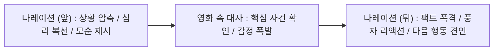

# 출발! 비디오 여행 나레이션 분석 (2026-10-20, agy gemini-3.8-flash-high)

> 사용자 "출비 확인했어? 분석하고 해. 그냥 ~죠만 줄이지 말고" — 공식 유튜브 4편(cewLpkOZc-k 왕과 사는 남자 · sE7Xy1leV7E 만약에 우리 · v-9n_jK7duQ 맨 끝줄 소년 · 4sYKHjd-Ljg 살목지) Speechmatics 받아쓰기 → agy 분석. 받아쓰기·소리는 cine_work/_bench_출발비디오여행.

MBC 「출발! 비디오 여행」(이하 '출비') 유튜브 영상 4편의 받아쓰기 데이터를 바탕으로 나레이션의 구조, 어미 분포, 장면 전환, 인물 소개, 대사 결합 방식 및 실전 집필 규칙을 종합 분석한 결과입니다.

---

### 1. 각 영상별 성우 나레이션 문장 추출
> **판단 근거**: 3인칭 관찰자·전지적 서술, 인물 및 배경 설정 설명, 줄거리 압축 요약, 시청자를 향한 유도/호응 멘트. (영화 속 등장인물의 1인칭 발화, 대화, 상황음은 완전 제외)

#### [영상 1] `cewLpkOZc-k` (영화: 왕과 사는 남자)
1. 피바람 분 한양에서 강원도 영월로 쫓겨 오게 된 어린 임금 단종.
2. 운명을 바꿀 어려운 손님을 맞이하게 된 마을 사람들.
3. 그 비극의 역사 속 숨겨진 이야기가 시작됩니다.
4. 숙부에게 왕위를 빼앗긴 비운의 왕 단종.
5. 그를 지키려 했던 평범한 사람들의 뜨거운 이야기.
6. 영화 왕과 사는 남자.
7. 한국 영화 최초로 단종의 삶을 조명한 영화는 그를 동정의 대상이 아니라 자신의 운명에 맞선 인간으로 그려냈는데요.
8. 장항준 감독 특유의 따뜻한 시선으로 담아낸 단종의 삶을 만나보시죠.
9. 준비되지 않은 채 보위에 오른 어린 왕.
10. 이름뿐인 왕의 자리는 바람 앞의 등불과 다름없었고,
11. 왕의 자리를 노리는 숙부 수양대군의 서슬 퍼런 야욕과 조정을 손안에 쥔 한명회는 어린 왕의 숨통까지 조여 왔지요.
12. 자신을 지키던 이들의 죽음을 무력하게 바라봐야만 했던 비운의 왕.
13. 한편 한양에서 멀리 떨어진 강원도 영월의 오지 광천골.
14. 당장 마을 사람들의 배를 채우는 게 더 급한 이곳의 실세는 촌장 엄흥도인데요.
15. 오랜만에 배불리 먹을 생각에 집중한 순간.
16. 하지만 결과는 처참, 촌장 체면이 말이 아닙니다.
17. 사슴 한 마리에 우왕좌왕하는 오합지졸 그 자체.
18. 걸음아 나 살려라, 목숨을 건 촌장의 줄행랑.
19. 꿈에 그리던 극락이 바로 여기였던 걸까요?
20. 오랜만에 맛본 쌀밥에 정신이 혼미해질 지경인데요.
21. 찢어지게 가난했던 마을에 굴러 들어왔다는 형조판서.
22. 없는 살림에 집도 내어주고 밥도 차려줘도 이 콧대 높은 양반이 어찌나 까탈스러운지.
23. 불만만 쌓여가던 어느 날,
24. 난데없이 형조판서에게 줄을 대려는 뇌물이 쏟아지고.
25. 판서를 따라 한양길에 오른 아이는 장원급제에 성공하며 마을의 운명을 바꿔 놓았습니다.
26. 제대로 돈 냄새 맡은 촌장 승부수를 던지기로 합니다.
27. 한바탕 소란으로 기회를 잡은 촌장님.
28. 마을의 운명을 쥔 절대권력자의 등장.
29. 나쁜 건 다 갖다 붙여 귀한 손님 모시기에 열을 올리는데요.
30. 사방이 꽉 막혀 마음까지 고립시킬 것 같긴 한데, 촌장님의 전략은 통할 수 있을까요?
31. 누가 오는지 꿈에도 모른 채, 온 마을은 금맥을 기대하는 중인데요.
32. 드디어 마을의 운명을 바꿀 그분이 왔습니다.
33. 거침없이 물살을 가르며 삼엄한 경비가 시작되고, 얼마나 대단한 분이기에 이 난리인가 싶어 가마 안을 살피는데
34. 권세를 등에 업은 권력자를 기대했건만 수염이 없네.
35. 정작 마주한 건 파리한 얼굴의 소년.
36. 순탄치 않은 앞날을 예고하듯 물길마저 발목을 잡는데요.
37. 한바탕 소란 속에서도 이미 모든 것을 놓아버린 듯 미동도 없는 소년.
38. 한편 조카의 유일한 편인 금성대군은 그의 복위를 준비하는데.
39. 하지만 이미 시들어버린 꽃처럼 생기를 잃어버린 어린 왕.
40. 어휴, 이런 첫날부터 가시밭길인데.
41. 청령포의 금맥을 바라던 사람들의 소망은 이대로 물거품이 되는 걸까요?
42. 고립된 어린 왕과 먹고살기 바빴던 사람들의 뜻밖의 동행.
43. 비극의 역사 속 우리가 몰랐던 순간들.
44. 기록 너머의 가장 뜨거운 진짜 이야기.
45. 영화 왕과 사는 남자입니다.

---

#### [영상 2] `sE7Xy1leV7E` (영화: 만약에 우리)
1. 먼저 만약에 우리입니다.
2. 고향 가는 버스에 올라탄 풋풋한 대학생 구교환.
3. 대학생이요? 뭐 얼굴에 10대부터 40대까지 다 있잖아.
4. 첫눈에 반했나 봐요.
5. 염색체만 보면 자동으로 심쿵 알람이죠.
6. 딱 자연스럽게 통성명할 타이밍이건만 고개 왼쪽으로 돌리면 죽니? 죽어?
7. 본투비 쑥맥 특징, 미녀 앞에만 서면 뚝딱거림이 한층 심해진다.
8. 그래도 얘는 해, 의자가 없으면 투명 의자라도 하고 벨트가 없으면 마임이라도 해.
9. 우와, 그게 또 어필이 됐나 봐요. 자고로 남녀 사이란 귀여워 보이면 끝 아닐지.
10. 버스는 사랑을 싣고 두 선남선녀의 핑크빛 미래로 달려가던 그 순간.
11. 오, 뭐야! 아이고 저 포르쉐예요 안녕!
12. 이보다 더 모양 빠지긴 힘든 모양새로 오도방정 원맨쇼를 선보입니다.
13. 차라리 기절을 하지.
14. 순간 본능적으로 마지막 찬스임을 직감한 모태 찐따.
15. 그렇지, 여기서 남자답게 나서야지.
16. 야, 우리 아버지 좀 치시는데요.
17. 간만에 본 아들, 자식보다 예비 며느리 대접에 진심인 아버지.
18. 얼큰한 거 잡숫는 건 여성분인데 삐질삐질 진땀 흘리는 건 이 집 아드님이죠.
19. 다행히 아버지의 활약으로 문가영과 절친 되기에 성공, 아이고 효도해라.
20. 그 뒤론 어미 찾는 똥강아지마냥 동아리 뒤풀이까지 졸졸 쫓아다니기 시작합니다.
21. 아 이거 딱 봐도 플러팅인데.
22. 열불 터지는 상황에도 그저 꿔다놓은 보릿자루 역할에 충실.
23. 안 그래도 허당인데 다급하니 더 모지리가 됐어요.
24. 그러던 그때, 다시 짝사랑녀와 절친이 된 소심남의 짠내 나는 삽질.
25. 만약에 우리입니다.
26. 이젠 서로의 자취방까지 드나드는 두 사람.
27. 아 뭐야 드나드는 사람 또 있잖아요.
28. 이 숙녀분으로 말씀드릴 것 같으면 컴퓨터 고수 구교환을 공짜 수리 기사로 쓰는 아는 누님이랄까.
29. 얌체네.
30. 생태계를 파괴하는 매력적인 퀸카 등장에 눈빛으로 용접을 시작한 여사친.
31. 눈에서 광선 나오시겠어.
32. 와 진짜 한 남자를 둘러싼 소리 없는 전쟁이네요.
33. 그때, 뭐야 애인이 있었어요?
34. 고객님 다음부터는 인근 서비스센터로 가실게요.
35. 설마 질투하나? 이런 게 친구면 난 친구 없다.
36. 하하하 여기서 이렇게 변화구를 던진다고? 아이구 맞아도 싸다 안 맞아도 싸.
37. 서로 다른 사람 만나는 꼴은 못 보지만 어쨌든 친구라고 주장하는 두 사람.
38. 진상이다, 그니까 그러면서 맨날 붙어있어.
39. 뽀뽀해! 뭐야 나 이거? 아니 이래도 안 사귄다고?
40. 가만있어봐 봐, 얘네 오늘 텐션이 좀 달라 달라.
41. 새로운 시작을 알리는 신호탄.
42. 아 이 좁아터진 자취방에서 이러고들 있으면 없던 정도 생기겠다 이것들아.
43. 지금 벌겋게 올라오는 홍조는 방방 돌아가는 보일러 때문인가 내 앞의 그대 때문인가.
44. 갑자기 냅다, 나 어떡해. 이래서 술과 밤이 있는 한 남녀 사이에 친구는 없다니까.
45. 아휴 이게 친구가 아니지.
46. 한땐 우정을 동력으로 가늘고 길게 함께하길 바랐건만 한번 고삐가 풀리니 쭉쭉 진도 빼기 바쁩니다.
47. 앞으로 얼굴 어떻게 보려고 이러는지 잠시 후에 따져 볼 거예요.
48. 이제 만약에 우리의 결말입니다.
49. 뜨밤 보낼 땐 언제고 갑자기 시베리아 벌판인 남과 여.
50. 아니 삐질 만하다.
51. 오빠한테 사귀어 줄까? 아니면 인간적으로 존댓말 해라.
52. 한참 오빠걸.
53. 이제 그만해 그만해! 재미들렸네 아주 정말!
54. 불안해하는 그녀에게 확신을 주는 남자의 한 방.
55. 이미 됐어.
56. 알지 알지, 심장 받고 별도 달도 따주고 싶은 젊은 날의 첫사랑.
57. 남들이 보면 유치찬란 애들 장난 같아도 지들끼리 좋아 죽죠.
58. 보는 우리는 안 괜찮아.
59. 효도는 언제 하니? 아버지는 오늘도 굴짬뽕 칼국수 만드느라 주부습진 낫지를 않아요.
60. 어떻게 이별까지 사랑하겠어, 다들 천년만년 갈 줄 알고 시작하지.
61. 드디어 사귀는 거예요? 피차 시간문제였습니다.
62. 꽁냥꽁냥 연애놀음에 열중하다 보니 어느덧 6년의 세월이 지났지요.
63. 가난이 죄다 죄야, 현실은 참 야속해요.
64. 좀 그만들 해, 이거 어떻게 사랑이 변하냐 이 자식들아 진짜.
65. 저 빈털터리 구교환은 이별 위기를 어떻게 극복해 낼까요?
66. 실제로는 12년 장기 연애 중이니 누구보다 잘 알지 않을까?
67. 임자가 있어도 멜로가 어색하지 않은 너란 남자 구교환의 미친 매력에 풍덩 빠지는 영화, 만약에 우리였습니다.

---

#### [영상 3] `v-9n_jK7duQ` (영화: 맨 끝줄 소년)
1. 먼저 맨 끝줄 소년입니다.
2. 깐깐하기로는 맨 첫 줄에 항상 이름이 오르내리는 교수 허문호 씨.
3. 국문과답게 주제를 잘 파악하라는 가르침.
4. 정작 주제 파악이 시급한 건 나였더라는 이야기.
5. 작품이라고는 20년 전에 쓴 소설 한 권이 전부, 영혼이라도 팔아서 글을 쓰고 싶은데 아무도 안 산대요.
6. 그래서 글 말고 말로 먹고 사는데
7. 베르테르 좀 읽었다고 거들먹대는 꼴이라니.
8. 맨 끝줄에 앉아 존재감도 없던 녀석에게 호기심이 생기던 바로 그때.
9. 수강신청을 얼마나 망했으면 공대생이 국문과 수업을 듣는지.
10. 스마트폰을 주웠을 뿐인데로 시작하는 녀석의 소설일랑 이렇습니다.
11. 바탕화면에서 마주친 말간 웃음, 어머님이 뉘신지 묻고 싶은 녀석을 처음 만난 건 입학 전 알바하는 식당에서였지요.
12. 감사하다는 뒤통수 뒤로 그 얼굴이 보인 순간 이상한 호기심이 발동하기 시작한 겁니다.
13. 상대의 관심사를 기반으로 한 전략적인 접근 시도.
14. 코딩 쉽지? 코 깨는 순간 딩동 심장 접수 완료.
15. 아 이걸 여기서 끊는다고? 작가님의 소설은 잠시 후에 계속 연재됩니다.
16. 다시 맨 끝줄 소년입니다.
17. 1회 연재만으로 열혈 독자 확보한 소년.
18. 모를 리가.
19. 남을 부러워하고 시기하고 질투하고 그런 마음에 있어서는 비교 자체가 실례인 이 분야 레전드께서 제안을 하나 하십니다.
20. 끝줄 소년이 알바까지 빼가며 문학 수업에 진심인 사이 강연에 알바 자리 났다는 소리에 냅다 달려온 교수님.
21. 이분 아까 면전에서 악플 달던 분이죠.
22. 하필이면 강연자가 잘나가는 작가이자 교수님의 대학 동기.
23. 질문한 학생 말고 교수님은 계실 텐데요.
24. 질투하는 마음이 커졌어, 진짜 커 공룡만 해.
25. 그 사이 2회차 연재를 시작한 작가님, 소제목은 엄마의 시크릿 가든 되겠습니다.
26. 정원에서 안방까지 이어지는 디테일한 묘사, 상상을 자극하는 문장에 점점 빠져드는 교수님.
27. 얘는 진짜 가둬두고 평생 글만 쓰게 해야 돼.
28. 꿀잼 보장된 다음 회차는 잠시 후에 계속 연재됩니다.
29. 교수님의 은밀한 개인교습, 맨 끝줄 소년의 결말입니다.
30. 난데없이 상견례용 멘트 날려주시는 어머니.
31. 그리고 아빠를, 어쩐지 배달 알바 뛰면서도 개근상 받았을 것 같고 잠은 학교에서 잤을 것 같은 캐릭터 설정.
32. 이 결핍 서사에 매료되고 보니 궁금한 게 있었죠.
33. 괜히 질문한 덕에 데뷔작만 파묘당한 교수님.
34. 같은 사람이면 헤매지는 않지, 12명을 어디 묻었으면 몰라.
35. 한편 애매했던 저녁 식사 이후 세윤의 가족과 부쩍 친해진 소년.
36. 설마 너 이것까지 계획에 있던 건 아니겠지?
37. 근데 교수님 이거 문학 수업 맞죠? 잠복 수사 아니죠?
38. 자, 과연 소년은 소설의 끝줄에 어떤 문장을 적게 될까요?
39. 교수님은 왜 이 소설에 집착하는 걸까요?
40. 왠지 소설 말고 진술서 써야 할 것 같다는 소년의 잔혹사, 맨 끝줄 소년이었습니다.

---

#### [영상 4] `4sYKHjd-Ljg` (영화: 살목지)
1. 어두컴컴한 저수지 앞에서 밤낚시를 즐기는 두 남녀.
2. 그리고 잠시 후, 차에서 맥주를 챙기던 여자가 저수지 쪽에서 무언가 심상치 않은 기운을 느낍니다.
3. 뭔가에 홀린 듯 물속으로 걸어 들어가는 그녀.
4. 온몸을 휘감는 서늘한 공포에 검은 심연을 들여다보던 그 순간.
5. 괴담이 끊이지 않는 한 저수지에서 포착된 정체불명의 형체.
6. 설명할 수 없는 기묘한 상황 속 아비규환에 빠진 이들의 처절한 생존기가 지금 시작됩니다.
7. 전국을 공포로 몰아넣은 심야 괴담의 레전드 에피소드가 영화로 재탄생했습니다.
8. 검고 깊은 물속에 사는 수귀의 저주, 한국형 호러영화 살목지입니다.
9. 한 지방 소도시에 위치한 저수지 살목지 로드뷰에 기분 나쁜 형상이 찍힌 사진 하나가 도착합니다.
10. 미디어 업체 PD 수인이 모두가 꺼리는 업무에 자원한 이유가 있었으니.
11. 사라진 선배 교식에 대한 의문을 안고 촬영팀과 함께 목적지에 도착한 그녀는 살목지의 평화로운 물결을 보며 왠지 모를 불안함을 느낍니다.
12. 그런데 그때.
13. 주차하던 차가 부딪친 건 어쩐지 음산한 분위기를 뿜어내는 마을의 돌탑이었죠.
14. 갑자기 어딘가에서 튀어나와 다시 돌탑을 쌓는 할머니.
15. 이럴 수가, 대체 그녀는 수인의 사연을 어떻게 알고 있는 걸까?
16. 한편, 촬영을 마치기엔 시간이 빠듯한 상황.
17. 하지만 어찌된 영문인지 기계가 먹통이 됩니다.
18. 그 타이밍에 모습을 드러낸 교식.
19. 그는 능숙하게 문제점을 파악하더니 물가로 향합니다.
20. 주저 없이 물속에 뛰어든 교식 덕분에 정상 작동하기 시작하는 GPS 기기.
21. 그러나 오랜만에 돌아온 그는 평소와는 다른 공기를 지니고 있었죠.
22. 교식의 활약으로 살목지 옆 산길을 따라 촬영을 재개한 팀원들.
23. 그렇게 카메라 감독이 홀로 산길 행군을 이어가던 중 모니터를 보던 수인이 무언가를 포착합니다.
24. 촬영된 영상을 다시 찬찬히 살펴보던 그때, 맙소사 그들 곁에 바짝 붙은 살목지의 혼령.
25. 하지만 함께 온 호러 방송 채널 운영자는 겁 없이 촬영을 강행하는데.
26. 저수지 건너편에서 실체를 드러내는 검은 존재.
27. 서둘러 이곳을 벗어나야 목숨을 부지할 수 있다는 직감.
28. 수인과 팀원들은 칠흑 같은 어둠 속에서 오직 내비게이션에 의지해 길을 찾습니다.
29. 아무리 더 빨리 더 멀리 도망쳐도 같은 곳으로 되돌아올 뿐.
30. 가까스로 이성의 끈을 부여잡고 침착하게 길을 찾던 그때.
31. 이럴 수가, 이미 그들은 원귀에 사로잡힌 걸까?
32. 그 누구도 쉽게 빠져나올 수 없는 살목지의 저주.
33. 그 끔찍한 괴담의 실체가 지금 모습을 드러내려 합니다.

---

### 2. 나레이션 문장 종결 어미 분류 통계 및 분석

영상 4편의 순수 나레이션 총 188개 문장을 기준으로 분류한 통계입니다.

| 어미 분류 유형 | 대표 예시 | 문장 수 | 비율(%) | 주요 기능 및 특징 |
| :--- | :--- | :---: | :---: | :--- |
| **1. 명사형 종결** | `~한 어린 왕.`, `~오합지졸 그 자체.` | **67** | **35.6%** | 영상 컷 전환과 호흡 일치, 압축적 상황 브리핑 |
| **2. ~ㅂ니다·습니다** | `~이야기가 시작됩니다.`, `~선보입니다.` | **37** | **19.7%** | 코너 시작/결말, 공식 서술, 단호한 팩트 전달 |
| **3. 반말 혼잣말·감탄** | `어휴`, `~다 있잖아.`, `~광선 나오시겠어.` | **28** | **14.9%** | 시청자 눈높이 리액션, 만담 코너(기막힌 이야기) 감초 |
| **4. 연결형 끊기** | `~어느 날,`, `~살피는데`, `~먹고 사는데` | **18** | **9.6%** | 문장을 덜 끝내고 영상/대사로 넘기는 징검다리 |
| **5. ~지요·~죠** | `~조여 왔지요.`, `~아드님이죠.` | **12** | **6.4%** | 시청자와 친밀한 공감대 형성, 뉘앙스 부드럽게 완화 |
| **6. 의문 (~ㄹ까요?)** | `~통할 수 있을까요?`, `~사로잡힌 걸까?` | **10** | **5.3%** | 위기 순간 몰입 유도, 다음 씬(광고/대사) 시청 견인 |
| **7. ~는데요·~ㄴ데요** | `~그려냈는데요.`, `~엄흥도인데요.` | **8** | **4.3%** | 새로운 배경 정보나 전제 조건을 자연스럽게 제시 |
| **8. 기타** | `~랄까`, `~아닐지`, `~가실게요` | **8** | **4.3%** | 독백형 종결, 능청스러운 어조 구사 |
| **합계** | - | **188** | **100.0%** | - |

> **분석 요약**: 
> 전체의 **35.6%가 체언(명사형) 종결**입니다. 동사로 풀어서 늘어놓지 않고 명사구로 딱딱 끊어주어야 영상의 템포가 처지지 않습니다. 또한 명사형 종결 뒤에 바로 다음 장면 컷이 붙거나 대사가 터져 나오는 리듬감이 출비 나레이션의 핵심입니다.

---

### 3. 장면·장소·인물이 바뀔 때 쓰는 접속 표현과 쓰임새

| 접속 표현 | 기능 및 쓰임새 | 영상 속 실제 예문 |
| :--- | :--- | :--- |
| **한편** | 공간이 물리적으로 떨어져 있거나, 다른 인물 진영의 상황을 병렬로 전환할 때 사용. | • *“한편 한양에서 멀리 떨어진 강원도 영월의 오지 광천골.”* (왕과 사는 남자) • *“한편 조카의 유일한 편인 금성대군은 그의 복위를 준비하는데.”* (왕과 사는 남자) • *“한편 애매했던 저녁 식사 이후 세윤의 가족과 부쩍 친해진 소년.”* (맨 끝줄 소년) |
| **그때 / 바로 그때 / ~던 그때** | 평온하던 흐름이 깨지며 돌발 위기나 제3의 인물이 등장할 때 긴박감을 줌. | • *“맨 끝줄에 앉아 존재감도 없던 녀석에게 호기심이 생기던 바로 그때.”* (맨 끝줄 소년) • *“촬영된 영상을 다시 찬찬히 살펴보던 그때, 맙소사.”* (살목지) • *“가까스로 이성의 끈을 부여잡고 침착하게 길을 찾던 그때.”* (살목지) |
| **그러던 어느 날 / 불만만 쌓여가던 어느 날** | 지루한 일상이나 반복되던 상태가 깨지고 본격적인 사건(발단)이 터지는 분기점. | • *“불만만 쌓여가던 어느 날, 난데없이 병조판서에게 줄을 대려는 뇌물이 쏟아지고.”* (왕과 사는 남자) |
| **드디어 / 마침내** | 빌드업된 기대감이 충족되거나 메인 인물/목적 대상이 모습을 드러낼 때. | • *“드디어 마을의 운명을 바꿀 그분이 왔습니다.”* (왕과 사는 남자) • *“마침내 세윤이와 친구가 됐다.”* (맨 끝줄 소년) • *“드디어 사귀는 거예요? 피차 시간문제였습니다.”* (만약에 우리) |
| **그 사이 / 그 타이밍에** | 다른 인물이 딴짓을 하거나 시간을 버는 틈새에 일어난 사건을 연결. | • *“그 사이 2회차 연재를 시작한 작가님, 소제목은 엄마의 시크릿 가든 되겠습니다.”* (맨 끝줄 소년) • *“그 타이밍에 모습을 드러낸 교식.”* (살목지) |

---

### 4. 인물 첫 소개 패턴 (압축 꾸밈말 + 이름 공식)
출비는 인물의 배경과 역할을 장황하게 설명하지 않고, **[처지·성향·상황 비유 꾸밈말] + [직함/이름]** 패턴으로 단 1초 만에 인물의 정체성을 시청자 머리에 박아 넣습니다.

1. **[처지/상황적 비유] + [직함/신분]**
   > *“피바람 분 한양에서 강원도 영월로 쫓겨 오게 된 어린 임금 단종.”* (왕과 사는 남자)
2. **[성격/세평 풍자] + [직함/이름]**
   > *“깐깐하기로는 맨 첫 줄에 항상 이름이 오르내리는 교수 허문호 씨.”* (맨 끝줄 소년)
3. **[공간 내 핵심 위치/성향] + [직함/이름]**
   > *“당장 마을 사람들의 배를 채우는 게 더 급한 이곳의 실세는 촌장 엄흥도인데요.”* (왕과 사는 남자)
4. **[외형적 처지/특징] + [직업/이름]**
   > *“고향 가는 버스에 올라탄 풋풋한 대학생 구교환.”* (만약에 우리)
5. **[소속/역할] + [이름] + [행동 동기 제시]**
   > *“미디어 업체 PD 수인이 모두가 꺼리는 업무에 자원한 이유가 있었으니.”* (살목지)
6. **[관계성 정의] + [인물/신분]**
   > *“조카의 유일한 편인 금성대군은 그의 복위를 준비하는데.”* (왕과 사는 남자)
7. **[캐릭터성 비틀기/역할 부여] + [인물 호칭]**
   > *“컴퓨터 고수 구교환을 공짜 수리 기사로 쓰는 아는 누님이랄까.”* (만약에 우리)

---

### 5. 나레이션과 대사의 짝 맞춤 기법

나레이션은 대사의 자막을 그대로 읽어주는 것이 아니라, 대사의 **'발판(밑밥)'**을 깔고, 대사가 끝난 후 **'의미(해설)'**를 거둡니다.

#### ① 나레이션이 대사 바로 앞에서 깔아 주는 것: `감정선 예열`, `상황의 모순`, `기대감 형성`
* **의문 던져 대사로 답하게 만들기**:
  * **나레이션**: *“사방이 꽉 막혀 마음까지 고립시킬 것 같긴 한데, 촌장님의 전략은 통할 수 있을까요?”*
  * **영화 속 대사**: *“이곳을 유배지로 지정한다.”* (나레이션의 질문에 대사가 즉각 답을 주어 쾌감을 줌)
* **인물의 모순된 속마음/위기를 미리 짚기**:
  * **나레이션**: *“생태계를 파괴하는 매력적인 퀸카 등장에 눈빛으로 용접을 시작한 여사친 눈에서 광선 나오시겠어.”*
  * **영화 속 대사**: *“은호야 싹 밀어줘.”* (여사친의 싸늘한 대사가 나오기 전 질투심을 나레이션이 시각적으로 과장해 둠)

#### ② 대사 바로 뒤에서 풀어 주는 것: `시청자 대변 리액션`, `풍자`, `상황 요약`
* **인물의 억울함/허탈함을 대신 코멘트**:
  * **영화 속 대사**: *“어린 놈은 그냥 싸가지 없이 그냥 어디 어른한테...”*
  * **나레이션**: *“어휴, 이런 첫날부터 가시밭길인데. 청령포의 금맥을 바라던 사람들의 소망은 이대로 물거품이 되는 걸까요?”* (대사의 감정을 받아 다음 위기 국면으로 전개)
* **대사가 만들어낸 팩트 확인 사살**:
  * **영화 속 대사**: *“너 우리 집 갈래?”*
  * **나레이션**: *“계획은 성공적이었다. 마침내 세윤이와 친구가 됐다.”* (대사 직후 성과를 한 줄로 정리하여 속도감 부여)
* **능청스러운 B급 리액션**:
  * **영화 속 대사**: *“내가 투자하면 되지, 나 뒷바라지할게.”*
  * **나레이션**: *“효도는 언제 하니? 아버지는 오늘도 굴짬뽕 칼국수 만드느라 주부습진 낫지를 않아요.”* (영화의 낭만을 현실적인 시청자 시선으로 깨부수며 웃음 유발)

---

### 6. 그 밖의 고유 연출 기법

#### ① 한 문장이 두 컷(두 화면)에 걸쳐 이어지는 '분절 서술'
문장을 한 호흡에 끝내지 않고, **연결어미(~는데, ~순간, ~건만)**에서 말을 멈추고 화면을 바꾼 뒤, 다음 컷에서 반전 결과를 터뜨립니다.
* **예문**: *“얼마나 대단한 분이기에 이 난리인가 싶어 가마 안을 살피는데”*  
  ➡️ `[화면 전환: 가마 문이 열리고 앳된 소년의 얼굴 컷]`  
  ➡️ *“권세를 등에 업은 권력자를 기대했건만 수염이 없네. 정작 마주한 건 파리한 얼굴의 소년.”*
* **예문**: *“모니터를 보던 수인이 무언가를 포착합니다.”*  
  ➡️ `[화면 전환: 모니터 속 저수지 확대 컷]`  
  ➡️ *“촬영된 영상을 다시 찬찬히 살펴보던 그때, 맙소사. 그들 곁에 바짝 붙은 살목지의 혼령.”*

#### ② 관용구와 트렌드 어휘를 교차하는 '비유·재치 한마디'
고전적인 사자성어/관용구와 인터넷 유행어·신조어를 자연스럽게 섞어 말맛을 극대화합니다.
* *“바람 앞의 등불과 다름없었고”* (클래식한 비유)
* *“사슴 한 마리에 우왕좌왕하는 오합지졸 그 자체”* / *“걸음아 나 살려라 목숨을 건 줄행랑”* (해학적 과장)
* *“코딩 쉽지? 코 깨는 순간 딩동 심장 접수 완료”* (음절 라임을 맞춘 재치)
* *“꿔다놓은 보릿자루”*, *“눈빛으로 용접을 시작한 여사친”*, *“데뷔작만 파묘당한 교수님”* (트렌디한 비유)

#### ③ 긴장 순간의 '미끼형 의문문' 던지기
시퀀스 말미나 다음 씬으로 넘어가기 전, 단정 짓지 않고 **~ㄹ까요? / ~걸까?**로 질문을 던져 시청자가 채널을 돌리지 못하게 붙잡습니다.
* *“촌장님의 전략은 통할 수 있을까요?”*
* *“청령포의 금맥을 바라던 사람들의 소망은 이대로 물거품이 되는 걸까요?”*
* *“대체 그녀는 수인의 사연을 어떻게 알고 있는 걸까?”*
* *“자, 과연 소년은 소설의 끝줄에 어떤 문장을 적게 될까요?”*

---

### 7. '출비' 스타일 나레이션 작성 10줄 체크리스트

1. **[명사형 30%]** 서술어(~다)를 남발하지 말고, 세 문장 중 하나는 명사형(~한 소년, ~의 시작)으로 툭툭 끊어 쳐라.
2. **[1초 인물 각인]** 인물이 처음 등장할 때는 반드시 `[처지/성격 압축 수식어] + [이름/신분]` 공식으로 소개하라.
3. **[분업의 원칙]** 나레이션은 상황과 복선만 깔아주고, 사건의 결정적 감정 확인은 영화 속 대사에게 넘겨라.
4. **[환승 신호어]** 장면이나 인물이 바뀔 때는 망설이지 말고 접속어(한편, 그때, 그러던 어느 날, 드디어)를 맨 앞에 박아라.
5. **[화면 걸치기]** 연결어미(~는데, ~순간)로 문장을 걸쳐 둔 채 화면을 전환하고, 다음 컷에서 반전을 터뜨려라.
6. **[대사 뒤 팩트 폭격]** 대사가 끝난 직후에는 시청자 시선의 리액션, 비틀기 풍자, 혹은 빠른 상황 정리를 덧붙여라.
7. **[말맛의 단짠]** 점잖은 관용구(바람 앞의 등불)와 찰진 신조어(플러팅, 파묘, 뚝딱거림)를 한 대본 안에서 교차하라.
8. **[어미 밀당]** 명사형 종결(빠른 호흡), ~는데요(배경 제시), ~지요(공감 유도), ~ㅂ니다(정보 전달)를 교대로 써서 리듬을 타라.
9. **[미끼 질문]** 씬이 전환되거나 위기가 닥쳤을 땐 설명하지 말고 의문문(~ㄹ까요?, ~걸까?)을 던져 시청자의 호기심을 낚아라.
10. **[40%의 여백]** 나레이션이 대사를 덮지 않도록, 대사 시작 전 1초와 끝난 후 1초의 오디오 틈새를 철저히 비워둬라.
